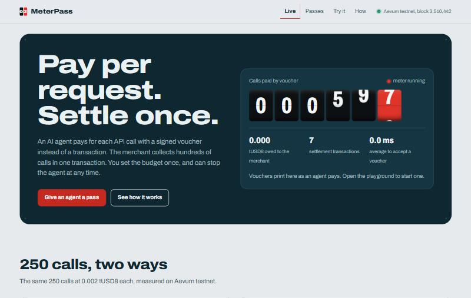
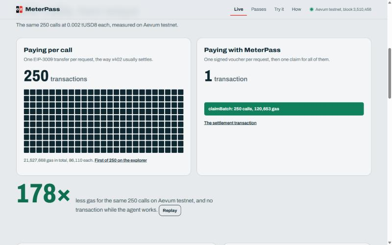
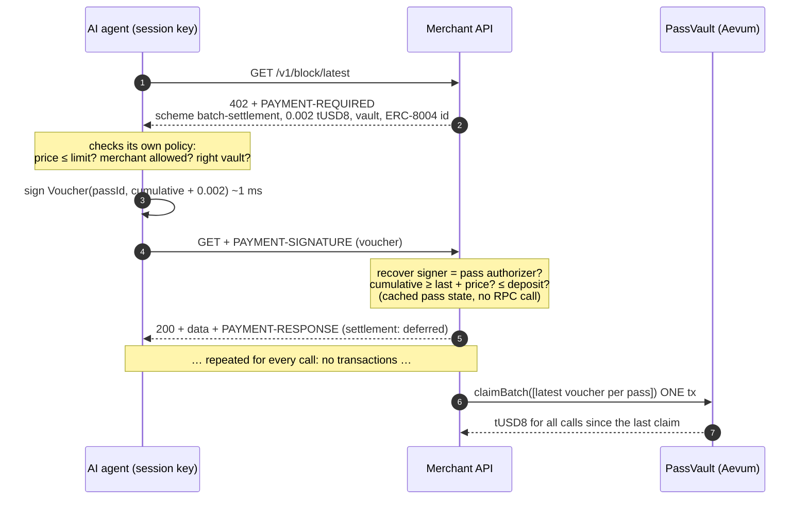
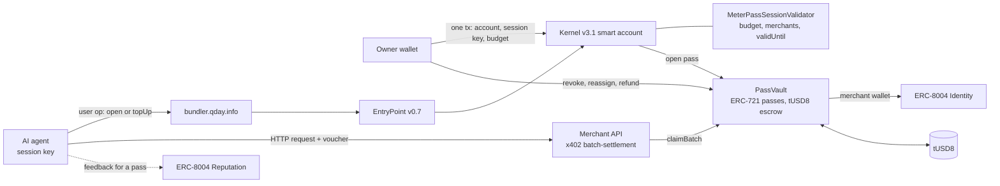
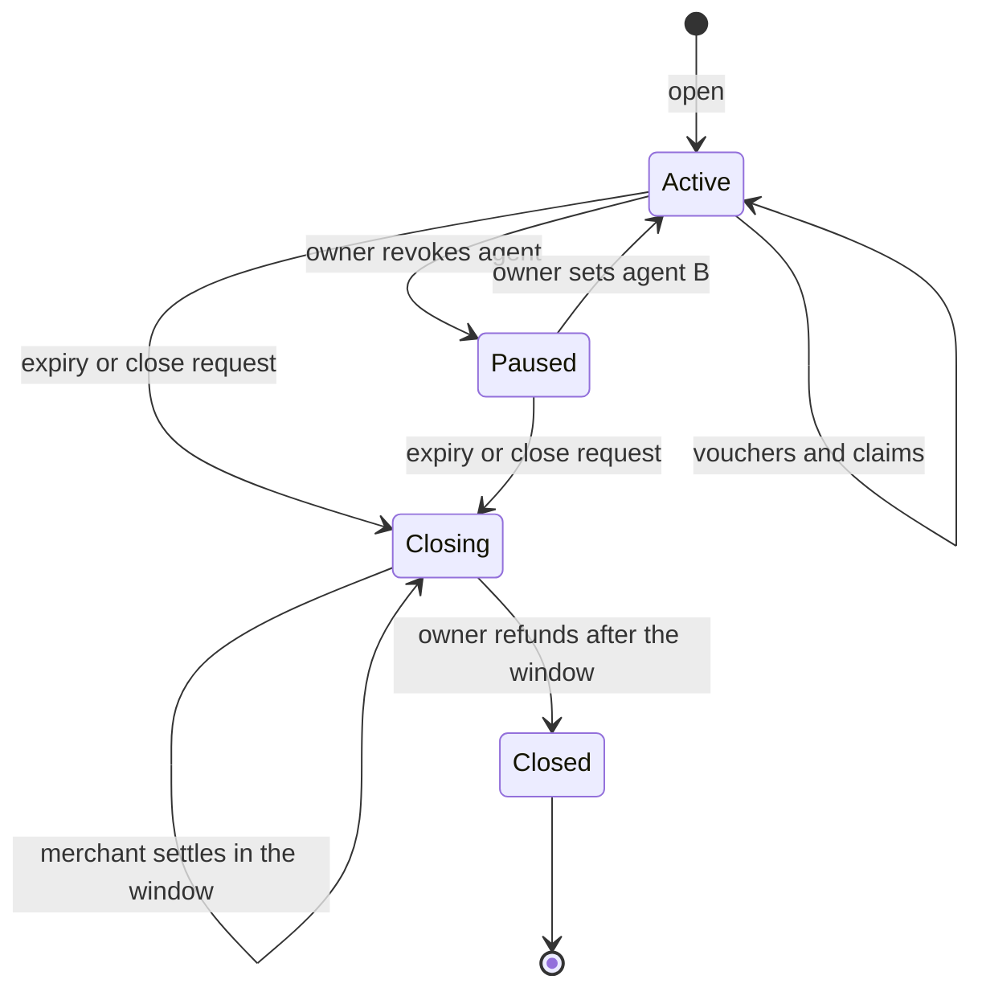

# MeterPass

**Pay per request without a transaction per request.**

AI agents pay for every API call with a signed voucher: no gas, about a millisecond to create.
The merchant collects hundreds of calls in **one** on-chain transaction. The owner sets a budget once
and can stop the agent at any time.

MeterPass is the first **x402 batch-settlement** implementation on **QDay Aevum testnet** (chain 44005).
It uses tUSD8, Kernel v3.1 smart accounts with a scoped session key, the Aevum ERC-4337 bundler and
ERC-8004 agent identity.

> Built for Aevum Builder Challenge #1 (DoraHacks). Testnet only: tUSD8 has no value.

| | |
|---|---|
| Live dashboard | **https://meterpass.vercel.app** (Live meter, Passes, Try it with your wallet, How) |
| Demo video | _link added before submission_ |
| Contracts | [Aevum testnet addresses](#deployed-on-aevum-testnet) |
| Source of the deployed contracts | commit [`4f43bd5`](https://github.com/opxy16/meterpass/tree/4f43bd5e9710d2334c29530084a34e4f9e3b923c) |



---

## Measured on Aevum testnet

The same 250 API calls at 0.002 tUSD8 each, paid two ways. Every number below comes from a real
run on chain 44005 (`deployments/metrics-44005.json`).

| | Per-call settlement (how x402 `exact` works) | **MeterPass** |
|---|---|---|
| What happens per call | one EIP-3009 `transferWithAuthorization` transaction | one signed voucher, off-chain |
| On-chain transactions | **250** | **1** ([`claimBatch`](https://explorer-test.qday.info/tx/0x1118b2a97743c65c94eaac697e3858b967a45bd935d7b1145510f081a66e387c)) |
| Gas | **21,527,668** (86,110 each) | **120,653** (about **178× less**) |
| Time | 93 s of transactions | 4.7 s for all 250 calls (18.8 ms per call over HTTP, 1.4 ms to sign) |
| Sample transactions | [first](https://explorer-test.qday.info/tx/0xa2b4d5475223f1778428428e5baf2d0f65bbbf6374b15aee3ed7aa13303d2fec), [last](https://explorer-test.qday.info/tx/0x18c838e90e55d550632f7bf035dfa462af289b4b6fafb9eda9476a5bebce0776) | [the one settlement](https://explorer-test.qday.info/tx/0x1118b2a97743c65c94eaac697e3858b967a45bd935d7b1145510f081a66e387c) |



At mainnet scale the gap grows with traffic: a settlement costs about the same whether it covers 250
calls or 25,000.

---

## The problem

Agents increasingly pay for what they use: an API call, a page of data, an inference. x402 brought
HTTP 402 "Payment Required" back for this, but in its usual form every request is its own on-chain
payment. At fractions of a cent per call, that means:

- **a fee on every call.** The gas often costs more than the thing being bought.
- **a wait on every call.** Each request waits for a transaction.
- **hard limits.** A prepaid balance kept in the vendor's database can't be checked by the buyer,
  and a raw wallet key gives the agent far too much power.

## The solution, in plain English

MeterPass works like a **prepaid meter**, or a payment channel:

1. **The owner approves once.** One transaction creates a smart account and gives the agent a
   *session key*. The key may only buy passes for approved merchants, up to a budget, until a date.
2. **The agent opens a pass.** A pass is an NFT that holds prepaid tUSD8 for one merchant. The owner
   keeps the NFT.
3. **Each request is paid with a voucher.** The agent signs "on pass #7 I have now used 0.502 tUSD8 in
   total" and sends it with the request. The merchant checks the signature in about a millisecond and
   serves the request. No transaction.
4. **The merchant settles in bulk.** Whenever it wants, the merchant submits the latest voucher and is
   paid the difference since its last claim: many calls, one transaction.
5. **Leftover money goes back.** When the pass expires, unused credit returns to the owner. The owner
   can also pause the agent, or hand the pass to another agent, at any time.

---

## How it works

### The request flow (x402 `batch-settlement`)



After the first quote the client remembers the price and pays on the first request, so a paid call
is a single HTTP round trip.

### The pieces



### A pass's life



---

## Safety model

| Threat | What stops it | Where |
|---|---|---|
| A prompt injection tells the agent "send 5 tUSD8 to 0x…" | The agent has no transfer tool, only "pay this request with a voucher on my pass". Its session key can't call the token at all. | `client.ts` policy · `MeterPassSessionValidator` (`TargetNotAllowed`) |
| A merchant quotes an absurd price | The agent checks price, merchant (ERC-8004 id), vault and network **before** signing anything | `selectRequirement` in `client.ts` |
| A leaked agent key | Total spend is capped by the session budget and each pass's deposit. The owner can revoke, rotate or uninstall it. | `MeterPassSessionValidator`, `PassVault.revoke/setAuthorizer` |
| The agent opens passes for someone else, or tops up an attacker's pass | Passes must be owned by the configured owner; only a pass's owner or original payer can top it up | validator `PassOwnerMismatch`, vault `NotFunder` |
| Replaying or reordering vouchers | Vouchers are **cumulative**: the vault pays `cumulative − claimed` and nothing for an older one. The EIP-712 domain binds them to the chain id and the vault; the message binds them to the pass. | `PassVault._settle` |
| Overdraft | A voucher above the deposit never settles | `ExceedsDeposit` + invariant test |
| The owner runs off without paying | Refunds open only after expiry (or a close request) **plus** the settlement window. The merchant claims well inside it (claim interval < window, enforced at merchant start-up). | `refundableAt`, `server.ts` |
| An honest merchant loses money on a revoke | Vouchers signed before a revoke stay claimable for the settlement window; the merchant settles automatically the moment it sees a revoke | `retiredAt`, auto-settle |
| A relayer changes the terms of a one-signature pass | The EIP-3009 nonce is the EIP-712 hash of every pass term | `openAuthNonce` |

**What "instant revoke" means, measured:** the owner's `revoke()` lands in a block. The merchant
polls vault events every 500 ms and refuses the pass from then on. On Aevum the agent got
`402 pass_revoked` **2.3 s after the revoke's block** (block timestamps have 1 s resolution). The
11 calls accepted in that gap (0.022 tUSD8) were paid from the deposit the owner had already
committed. Exposure after a revoke is bounded by price × request rate × that delay.

---

## Deployed on Aevum testnet

Chain id `44005`, RPC `https://rpc-test.qday.info`, explorer `https://explorer-test.qday.info`.
The explorer's verifier isn't working yet, so the source is pinned by commit instead: the contracts
deployed are those in commit [`4f43bd5`](https://github.com/opxy16/meterpass/tree/4f43bd5e9710d2334c29530084a34e4f9e3b923c/contracts/src)
(contract source unchanged since `6119ec9`). Deployed with CREATE2 through the deterministic deployer,
salt `keccak256("meterpass.v1")`.

| Contract | Address |
|---|---|
| PassVault | [`0xa81D0B14D94036C51D7f15e492Ed11637Bd21B13`](https://explorer-test.qday.info/address/0xa81D0B14D94036C51D7f15e492Ed11637Bd21B13) |
| MeterPassSessionValidator | [`0xE276a5f14A12B5B5ccC8FD6c1d74d2B03D4791EF`](https://explorer-test.qday.info/address/0xE276a5f14A12B5B5ccC8FD6c1d74d2B03D4791EF) |
| ERC-8004 AgentIdentityRegistry | [`0x6486Cc21360b79A59FB1eFcC7e7e925485ef9Af1`](https://explorer-test.qday.info/address/0x6486Cc21360b79A59FB1eFcC7e7e925485ef9Af1) |
| ERC-8004 ReputationRegistry | [`0xd69B3e2796Dd4e641d8C914ae606cCf70ea8460f`](https://explorer-test.qday.info/address/0xd69B3e2796Dd4e641d8C914ae606cCf70ea8460f) |
| tUSD8 (existing) | [`0x456569838f1d43009A91ebA4263147Afd7233483`](https://explorer-test.qday.info/address/0x456569838f1d43009A91ebA4263147Afd7233483) |
| EntryPoint v0.7 (existing) | `0x0000000071727De22E5E9d8BAf0edAc6f37da032` |
| Kernel v3.1 factory / ECDSA validator (existing) | `0xaac5D4240AF87249B3f71BC8E4A2cae074A3E419` / `0x845ADb2C711129d4f3966735eD98a9F09fC4cE57` |

Demo merchant: ERC-8004 agent **#1** (`eip155:44005:0x6486…9Af1`), wallet `0x3F281fFabcc88146bD4604890E1f2AF99d4C85ca`.
Demo smart account: `0x847C5A3ffc09fc0Df1C37eE2583AA275405826C4`.

### The demo, transaction by transaction

The full log is in [`deployments/evidence-44005.json`](deployments/evidence-44005.json).

| Step | Transaction |
|---|---|
| Owner: **one** tx creates the Kernel account, installs the agent's session key, approves a 1.2 tUSD8 budget | [`0xb576…189d`](https://explorer-test.qday.info/tx/0xb5765153c959d508133cff0524a772f684b9da1a87d50a7a1cf0d8267260189d) |
| Agent A opens pass #1 (1 tUSD8) with its session key **through bundler.qday.info** | [`0x26b3…a85d`](https://explorer-test.qday.info/tx/0x26b359c54d5d9c1ecb4d712f0eb339ea8d587b041ad38baceab6e87ba15fa85d) |
| 250 paid calls | _none: vouchers are off-chain_ |
| Merchant settles all 250 calls in **one** `claimBatch` (120,653 gas) | [`0x1118…387c`](https://explorer-test.qday.info/tx/0x1118b2a97743c65c94eaac697e3858b967a45bd935d7b1145510f081a66e387c) |
| Over-priced quote (5 tUSD8) refused; injected transfer blocked by the session policy | _none: refused before anything is signed or sent_ |
| Agent A opens pass #2 via the bundler | [`0x3cbb…f737c`](https://explorer-test.qday.info/tx/0x3cbbdb9b68100b528b51902c9acb665ba3f08b2e3a02689b2e1061a754cf737c) |
| Owner revokes pass #2 mid-run → next request 402 | [`0x504b…4989`](https://explorer-test.qday.info/tx/0x504b1ae988aab0cd40dfe8dd573982870bd6a5a8e3371aa61a6805b7e34d4989) |
| Owner hands pass #2 to agent B (B verifies A's last voucher and continues) | [`0x65f8…71c`](https://explorer-test.qday.info/tx/0x65f863e2fc93855624c62558d5dbfbba338ab01cc509975a9a565ada49ce371c) |
| Merchant settles agent B's calls | [`0xeb2a…bff`](https://explorer-test.qday.info/tx/0xeb2acd497cc0aa163b0c8f92e13fc88012724ccd0dd267e156f9a55621aabbff) |
| Owner refunds pass #3 after expiry + settlement window | [`0x3f06…a776`](https://explorer-test.qday.info/tx/0x3f06eaaafbfea18f7648ae0fb9d3cc7eaabe8e7754a08cdf99685f512c5fa776) |

The log also shows two smart accounts funded by mistake during setup (a script bug, fixed). Their
2.4 tUSD8 was recovered to the owner with root-key user operations through the bundler.

---

## Platform integration

| Aevum / QDay feature | How MeterPass uses it |
|---|---|
| **tUSD8** (6 decimals, EIP-3009, domain `tUSD8` v`2`) | The unit of every pass, voucher and claim. `openWithAuthorization` opens a pass from one EIP-3009 `ReceiveWithAuthorization` signature. |
| **ERC-4337 EntryPoint v0.7 + Kernel v3.1** | The owner's smart account. `MeterPassSessionValidator` is a Kernel (ERC-7579) validator module selected through the Kernel nonce key. |
| **bundler.qday.info** (rundler fork) | Every agent action (opening and topping up passes) and the owner's recovery operations are user operations sent through it. |
| **ERC-8004** | Merchants are registered agents: a pass is opened for a merchant **agent id** and pays its `agentWallet`. The session key allowlists agent ids. `PassVault.settledVolume(agentId)` is verifiable revenue; the Reputation registry takes feedback tagged with a pass id. |
| **x402 v2** | Standard headers (`PAYMENT-REQUIRED`, `PAYMENT-SIGNATURE`, `PAYMENT-RESPONSE`) and 402 flow, new scheme `batch-settlement`, network `eip155:44005`. |
| **Shanghai EVM** | Compiled for Shanghai with OpenZeppelin 5.1 (5.4 uses `mcopy`); `scripts/check-shanghai.mjs` scans bytecode for Cancun opcodes. |
| **1,000-block `eth_getLogs` limit** | The SDK's `getLogsChunked` and the merchant's pass cache read in ≤1,000-block windows. |

### Known constraints (and what we did)

- **The Kernel factory isn't staked on Aevum**, so bundlers (ERC-7562) refuse to deploy a Kernel
  account inside a user operation when deployment touches validator storage. The owner therefore
  creates the account with one ordinary transaction (Kernel's `initConfig` installs the session module
  and approves the budget in that same transaction). Everything after that goes through the bundler.
- **No public x402 facilitator endpoint for Aevum** was found, so the merchant verifies vouchers
  itself. That is the point of this scheme anyway: verification needs no chain call.
- **The explorer can't verify source yet**, so the deployed source is pinned by commit (above).
- **Revocation is bounded by block time plus polling**: about 2 s on Aevum today. QDay's planned
  sub-second blocks shrink it further.
- **The hosted playground's relayer rate limits live in memory** per serverless instance. Keep only
  a little tQDAY in the relayer.

---

## Repository layout

```
contracts/                 Foundry (Solidity 0.8.28, EVM Shanghai)
  src/PassVault.sol          passes, vouchers, claims, revoke/reassign, refunds, on-chain SVG art
  src/session/MeterPassSessionValidator.sol   Kernel v3.1 session-key module
  src/erc8004/               minimal ERC-8004 Identity + Reputation registries
  test/                      unit, fuzz, invariant, and fork tests against real Aevum contracts
  script/Deploy.s.sol        CREATE2 deployment, writes deployments/<chainId>.json
packages/sdk/              @meterpass/sdk: vouchers, x402 codec, paying fetch, merchant verifier,
                           pass cache, batch settlement, Kernel session account, bundler/direct user ops
packages/node/             env + network helpers for the Node apps
apps/merchant/             demo merchant API (Hono): paid routes, SSE feed, auto-settlement
apps/agent/                demo runner: every scenario of the demo video
apps/web/                  Next.js dashboard + hosted merchant, relayer and settle routes
deployments/               addresses, evidence (tx hashes) and measured metrics per chain
scripts/                   wallet generator, secret guard, Shanghai check, local fork
```

---

## Run it

### Requirements

Node 22+, pnpm 10 (`corepack enable`), Foundry (`foundryup`), git.

```bash
git clone https://github.com/opxy16/meterpass.git
cd meterpass
pnpm install
pnpm wallets          # makes 5 TEST wallets; keys go only to .env.wallets (git-ignored), prints addresses
```

### Tests

```bash
cd contracts
forge test                                  # unit + fuzz + invariant
AEVUM_FORK=1 forge test --match-path "test/fork/*"   # against the real EntryPoint, Kernel and tUSD8
cd ../packages/sdk && pnpm test             # agent ↔ merchant round trips
```

### Everything locally, on a fork of Aevum (no faucet needed)

```bash
bash scripts/fork-up.sh                                   # anvil fork (chain 440050), funds wallets, deploys, registers merchant
METERPASS_NETWORK=fork pnpm --filter @meterpass/merchant start      # terminal 1
cd apps/agent
METERPASS_NETWORK=fork pnpm demo setup                    # owner: one tx -> account + session key + budget
METERPASS_NETWORK=fork pnpm demo open --amount 1          # agent opens a pass
METERPASS_NETWORK=fork pnpm demo run --calls 250          # 250 paid calls, 0 transactions
METERPASS_NETWORK=fork pnpm demo settle --requests 250    # one claimBatch
```

On the fork, user operations go straight to the EntryPoint (`SUBMIT=direct`); on Aevum they go
through the bundler.

### On Aevum testnet

1. Fund the DEPLOYER address from the QDay Discord faucet (`/faucet <address>`, 1 tQDAY + 5 tUSD8).
2. `pnpm --filter @meterpass/agent demo fund` spreads it to the owner and merchant test wallets.
3. Deploy and register:
   ```bash
   cd contracts && set -a && . ../.env.wallets && set +a
   forge script script/Deploy.s.sol --rpc-url aevum --broadcast --legacy --slow
   cd .. && pnpm --filter @meterpass/merchant register
   ```
4. Start the merchant (`pnpm --filter @meterpass/merchant start`), then run the demo:
   `setup`, `open`, `run`, `settle`, `inject`, `run --revoke-after 10 --interval-ms 100`, `reassign`,
   `run --agent B`, `baseline --n 250`, `refund-open`, `refund`.

### Dashboard

```bash
pnpm --filter @meterpass/web dev     # http://localhost:3000
```

### Environment variables

| Variable | Used by | Meaning |
|---|---|---|
| `DEPLOYER/OWNER/MERCHANT/AGENT_A/AGENT_B_PRIVATE_KEY` | scripts, apps | test keys, generated into `.env.wallets` by `pnpm wallets` (never commit) |
| `METERPASS_NETWORK` | merchant, agent | `aevum` (default), `fork` or `local` |
| `AEVUM_RPC` | all | RPC override (default `https://rpc-test.qday.info`) |
| `MERCHANT_URL` | agent | merchant base URL (default `http://localhost:8787`) |
| `MERCHANT_ADMIN_TOKEN` | merchant, agent | protects `POST /admin/settle`; put it in `.env.local` |
| `SETTLE_INTERVAL_SECONDS` | merchant | auto-settle interval; must be shorter than the vault's settlement window (default 60) |
| `PASS_POLL_MS` | merchant | how often the merchant checks vault events (default 500) |
| `SUBMIT` | agent | `bundler` (default on Aevum) or `direct` (EntryPoint from an EOA) |
| `AGENT_MAX_PRICE` | agent | highest price per request the agent accepts (default `0.01`) |
| `NEXT_PUBLIC_CHAIN_ID` | web | `44005` (default) |
| `NEXT_PUBLIC_MERCHANT_URL` | web | external merchant URL; default is the dashboard's own `/api/merchant` |
| `NEXT_PUBLIC_REPO_URL` | web | link to this repository |
| `RELAYER_PRIVATE_KEY` | web (server) | the only key the hosted site needs: pays gas for one-signature pass opening and submits `claimBatch` (which always pays the merchant's wallet, whoever sends it). Keep it lightly funded. |
| `UPSTASH_REDIS_REST_URL` / `UPSTASH_REDIS_REST_TOKEN` | web (server) | optional shared voucher store for the hosted merchant |
| `TRUSTED_IP_HEADER` | web (server) | client-IP header for rate limits (`x-vercel-forwarded-for` on Vercel) |

---

## Use the SDK

**Agent side**: pay any `batch-settlement` API, within limits that don't depend on what the server says:

```ts
import { createMeterPassFetch } from "@meterpass/sdk";

const pay = createMeterPassFetch({
  signer: agentKey,                 // the pass authorizer (session key)
  chainId: 44005,
  passId: 7n,
  policy: {
    network: "eip155:44005",
    asset: TUSD8,
    vault: PASS_VAULT,
    maxAmountPerRequest: 10_000n,   // 0.01 tUSD8
    allowedMerchantAgentIds: [1n],  // ERC-8004 ids
  },
});
const res = await pay("https://api.example/v1/block/latest");
```

**Merchant side**: verify in about a millisecond, settle in bulk:

```ts
import { MeterPassMerchant, ChainPassCache, settleBatch } from "@meterpass/sdk";

const passes = new ChainPassCache(publicClient, PASS_VAULT, 500);
await passes.start();
const merchant = new MeterPassMerchant({ chainId: 44005, vault: PASS_VAULT, asset: TUSD8, payTo, merchantAgentId: 1n,
  identityRegistry, settlementWindow: 300, passes, store });

const r = await merchant.verify(resource, 2_000n, req.headers.get("PAYMENT-SIGNATURE"));
if (!r.ok) return new Response(null, { status: r.status, headers: { "PAYMENT-REQUIRED": r.requiredHeader } });

await settleBatch({ publicClient, walletClient, vault: PASS_VAULT, vouchers: await merchant.claimable() });
```

---

## Who it's for, and the business model

- **API and data sellers** who want to charge agents per request at sub-cent prices without a fee per
  call, and want a receipt they can verify (`settledVolume` on-chain, ERC-8004 reputation).
- **Agent operators and owners** who need hard limits: a budget, an allowlist, an expiry, instant
  pause, and leftover credit back.
- **Revenue:** a protocol fee on settlement (basis points on `claimBatch`), a hosted facilitator and
  settlement service for merchants who don't want to run a settler, and pass resale or transfer as
  passes carry prepaid credit.

## Roadmap

- Mainnet (Q1 2027) with USD8; pay gas in USD8 via QDay's stablecoin paymaster.
- A staked factory, or the paymaster, so even account creation goes through the bundler.
- Push-based revocation (merchant subscribes to new blocks) to bring the revoke gap under one block.
- Multi-merchant passes (one deposit, several ERC-8004 merchants) and per-merchant sub-budgets.
- An MCP tool so any agent framework can pay `batch-settlement` APIs with its session key.

---

## Tests

`forge test` (with `AEVUM_FORK=1`): **60 passed, 0 failed**, plus **7** SDK tests.

| Suite | Tests | What it covers |
|---|---|---|
| `PassVault.t.sol` | 25 | opening, the 250-vouchers/1-claim loop, replay, reorder, overdraft, cross-pass / cross-vault / cross-chain binding, batch skipping, revoke window, reassign, transfer, top-up rules, refunds, EIP-3009 open (incl. relayer tampering and replay), on-chain metadata |
| `PassVault.fuzz.t.sol` | 6 (1,024 runs each) | any increasing voucher sequence pays exactly the final amount; nothing above the deposit; random keys can't sign; money is conserved; retired keys only inside the window; no early refund |
| `PassVault.invariant.t.sol` | 5 invariants (128 runs × 64 random actions) | money conserved, vault solvent, claims ≤ deposit, claimed never decreases, `settledVolume` matches payouts, under random opens, top-ups, claims, replays, revokes, reassignments, closes, refunds and time jumps |
| `SessionValidator.t.sol` | 18 (incl. a budget fuzz) | only `open`/`topUp` on PassVault, owner-only passes, merchant allowlist, expiry ≤ session, cumulative budget, no token calls, no ETH value, no delegatecall, no other account functions, wrong signer, revoke, rotate, uninstall, isolation between accounts, no ERC-1271 |
| `Erc8004.t.sol` | 6 | registration, metadata, reserved `agentWallet` key, wallet change needs the new wallet's signature, transfer clears the wallet (passes can't open), reputation tied to a pass, no self-feedback |
| `fork/KernelSession.fork.t.sol` | 4 | on a fork of Aevum with the **real** EntryPoint v0.7, Kernel v3.1 factory, ECDSA validator and tUSD8: owner setup, agent opens a pass through `handleOps`, token transfer rejected (`AA23` + `TargetNotAllowed`), budget exceeded, revoked session (`AA24`) |
| `packages/sdk` | 7 | agent ↔ merchant round trips: 250 calls, over-priced quote refused before signing, revoked pass → 402, replay → `stale_cumulative`, over deposit → `insufficient_funds`, wrong key, no RPC per request |

## Licenses and credits

MIT, see [LICENSE](LICENSE). All MeterPass code was written during the build window (from 16 Nov 2026).
It does not copy the x402 reference contracts or the Aevum starter kit; chain facts (tUSD8 domain,
1,000-block log limit, Shanghai) were checked against the
[Aevum Starter Kit](https://github.com/qday-io/aevum-starter-kit) docs.

Third-party code: OpenZeppelin Contracts 5.1 (MIT), forge-std (MIT/Apache-2.0, vendored in
`contracts/lib/forge-std`), viem (MIT), Hono (MIT), Next.js and React (MIT). Specifications:
x402 v2 HTTP transport, ERC-8004, ERC-4337 v0.7, ERC-7579, EIP-712, EIP-3009. Kernel v3.1 by ZeroDev
is used as deployed on Aevum, not copied.
